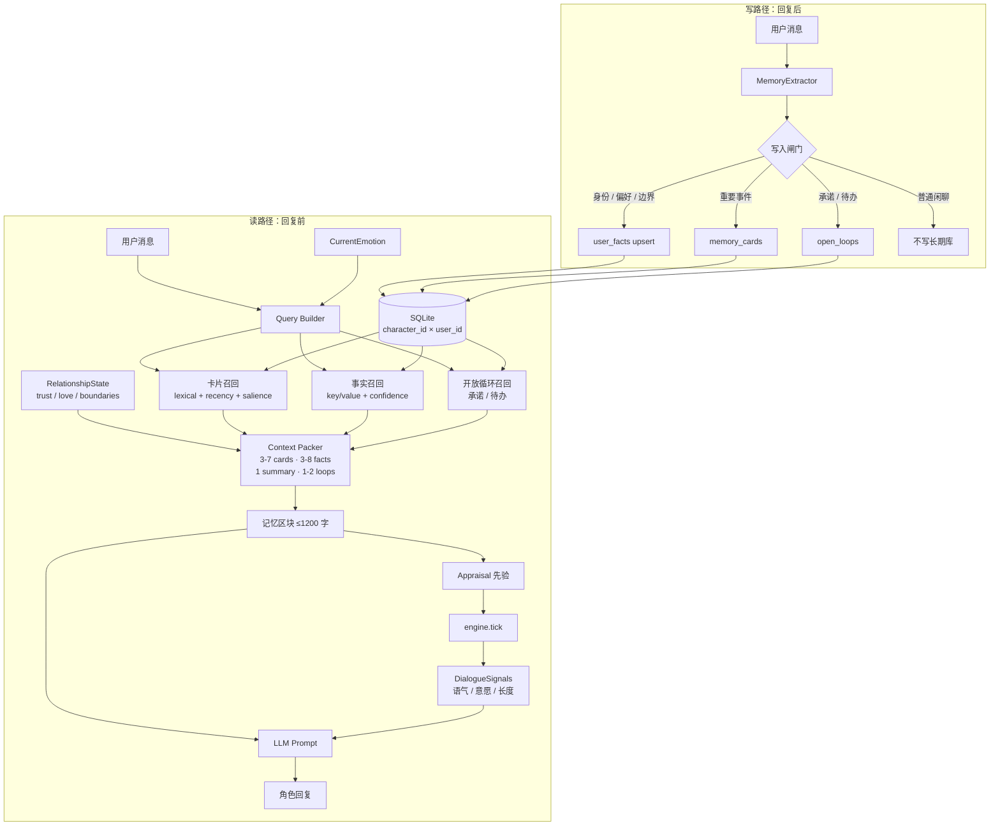
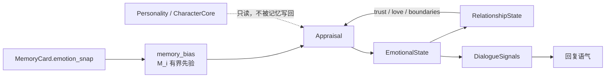

# 关系域长期记忆系统 v0.2（L4）

> 目标：让 AI 记住「这个人、这段关系」，而不是把整段聊天记录塞进上下文。
>
> 代码：`memory.py` · 测试：`test_memory_system.py` + `test_l4_memory_integration.py` · 演示：`python memory.py`
> 相邻控制层：`tolerance.py`（耐受窗）· 设计见 [`TOLERANCE.md`](TOLERANCE.md)

L4 已把记忆先验接进 `Appraisal`，并补上关系摘要自动刷新、写入闸门 v2、
旧 `MemoryStoreDB` 迁移工具、1200 字预算压测与有/无记忆消融测试。

---

## 1. 设计边界

这套记忆系统只做三件事：

1. **记住对方**：身份、偏好、边界、承诺、重要事件、关系摘要。
2. **反过来影响对话**：召回内容进入 prompt；情绪快照可作为 appraisal 先验。
3. **不改变自身底色**：记忆永远不写 `Personality` / `CharacterCore`。

```text
CharacterCore（角色底色，慢变/锁定）
        │
        ├── Personality / OCEAN / 价值排序 / 说话方式
        │
RelationshipState（每个用户一份，可变化）
        │   trust / love / familiarity / boundaries / summary
        │
MemoryCard + UserFact + OpenLoop（每个用户一份）
        │   事件卡 / 结构化事实 / 承诺与待办
        │
CurrentEmotion（每帧状态）
            joy / sadness / anger / fear / ...
```

**硬约束：**

- 记忆按 `(character_id, user_id)` 隔离，不跨用户召回。
- 不存全量聊天记录；长期库只存压缩后的卡片、事实、承诺。
- 进入 prompt 的记忆有预算，默认 ≤ 1200 字。
- 记忆可以影响 appraisal / relationship / 语气，但不能直接改人格参数。

---

## 2. 信息流总图



### 读路径的关键点

- **不是先召回再判断是否相关**：先按 lexical / recency / salience 取候选，再统一打分、截断。
- **关系摘要是最高压缩层**：一到两句话概括「我们是什么关系」，优先于零散事件。
- **开放循环负责连续性**：AI 记得「你上周说周五要汇报」，比记得十段闲聊更像真的记得。
- **预算固定**：卡片 3–7 张、事实 3–8 条、关系摘要 1 条、开放循环 1–2 条。

### 写路径的关键点

- **写入前先过闸门**：不是每句话都值得进长期库。
- **事实用 key/value 存储**：同一 key 的新值会把旧值标记为 `superseded`，保留历史但不污染当前事实。
- **承诺单独存**：进入 `open_loops`，完成后关闭。
- **原文只留引用**：`raw_ref` 指向消息 id，不把整段原文放进记忆卡。

---

## 3. 情绪如何参与



- 卡片保存存储时的 `emotion_snap`、`appraisal`、`salience`、`confidence`。
- `memory_bias()` 把情绪快照压成一个有上限（默认 ±0.2）的十通道先验。
- `appraisal_prior()` 把卡片里的六维 `appraisal` 减去中性基线后加权平均，
  得到同样有界（±0.2）的六维先验；这是 L4 真正进入 `engine.tick()` 的接口。
- 先验只作用于 `Appraisal` / `RelationshipState`，**不直接拉当前情绪状态，更不写人格**。
- 关系状态反过来影响 appraisal：高 trust 会降低威胁解释，boundary 会提高某些事件的负面权重。

### L4：先验如何进入 Appraisal

```text
memory_cards.appraisal
        │  salience × confidence × exp(−age / 30d)
        ▼
appraisal_prior()  → 每维 clamp 到 ±0.2
        │
        ▼
core.apply_appraisal_bias(appraisal, prior)
        │  只改六维评估，并按各维合法范围 clamp
        ▼
engine.tick(appraisal_bias=prior)
        │  无 prior：完全不创建新对象，trace 键集合不变
        ▼
appraise() → gate → state
```

边界：

- `expectedness / coping_potential` 的中性值是 `0.5`，不是 `0`；
  记忆卡里没有存这两维时按中性处理，不伪造“更可控/更意外”。
- 只有带 `appraisal` 的卡片参与六维先验；只有情绪快照的旧卡片不影响
  `appraisal_prior()`，但仍参与 `memory_bias()` 的通道先验。
- `engine.tick(..., appraisal_bias=...)` 在没有 `Appraisal` 时不会拉状态。
  文本 → `Appraisal` 由 L6 的 `jev.py` 提供（默认关闭）；L4 只保证先验接口已就位。
- trace 新增 `memory_bias_enabled / memory_bias_applied /
  appraisal_before_memory` 三个键，且只在显式传入先验时出现。

---

## 4. 数据模型

### `memory_cards`

压缩后的事件/边界/里程碑卡片。

| 字段 | 说明 |
|---|---|
| `character_id`, `user_id` | 关系域隔离 |
| `scope` | `self` / `relation` / `world` / `session` |
| `kind` | `episode` / `boundary` / `milestone` / `conflict` / `preference` / `note` |
| `summary` | 30–80 字，直接进入 prompt |
| `tags` | 检索辅助 |
| `appraisal` | 事件六维评估快照 |
| `emotion_snap` | 情绪十通道快照 |
| `salience` | 情绪显著性 |
| `confidence` | 记忆可信度 |
| `source` | `user_said` / `observed` / `inferred` / `canon` |
| `raw_ref` | 原文引用，不直接进 prompt |
| `status` | `active` / `superseded` / `deleted` |

### `user_facts`

结构化事实，负责「稳定信息」。

| 字段 | 说明 |
|---|---|
| `key` | 如 `identity.name` / `preference.like.猫` / `boundary.被说教` |
| `value` | 自然语言值，如 `不喜欢被说教` |
| `category` | `identity` / `preference` / `boundary` / `general` |
| `confidence` | 事实可信度 |
| `evidence` | 原文引用列表 |
| `status` | 同一 key 只有一条 `active` |

### `relationships`

每个角色 × 用户一行。

| 字段 | 说明 |
|---|---|
| `trust` / `love` / `familiarity` | 0–1 |
| `boundaries` | 明确边界列表 |
| `summary` | 关系摘要，最高压缩层 |

### `open_loops`

承诺、待办、未解决冲突。

| 字段 | 说明 |
|---|---|
| `summary` | 如「周五项目汇报」 |
| `due_at` | 可选截止时间 |
| `importance` | 0–1 |
| `status` | `open` / `closed` / `cancelled` |

### 检索索引

- 使用 SQLite FTS5 `unicode61`。
- 中文先切成 **CJK bigram** 再写入 `search_text`；英文按词切。
- 没有 FTS5 时自动退回 Python 词法打分。
- 不依赖 embedding，也不需要把中文文本发到外部服务。

---

## 5. 召回评分

卡片：

```text
score = 0.35 * lexical
      + 0.20 * recency       # exp(-age_days / 30)
      + 0.20 * salience
      + 0.15 * kind_importance
      + 0.10 * confidence
```

事实：

```text
score = 0.45 * lexical
      + 0.20 * category_weight
      + 0.20 * confidence
      + 0.15 * recency        # exp(-age_days / 90)
```

召回不是「查聊天记录」，而是「在有限预算内，找回最可能影响此刻对话的几件事」。

---

## 6. 使用方式

```python
from memory import RelationshipMemoryStore, MemoryService

store = RelationshipMemoryStore("memory.db")
memory = MemoryService(store)

# 回复前：构建记忆区块
context = memory.build_context(
    character_id="furina",
    user_id="alice",
    query="今天又被老板骂了。",
)
print(context)

# 回复后：抽取事实 / 边界 / 承诺
memory.remember_turn(
    character_id="furina",
    user_id="alice",
    user_text="我叫小枫，我不喜欢被说教，我答应周五把方案发给你。",
    emotion_snap={"sadness": 0.6, "trust": 0.4},
)

# 重要事件可以显式写入（不依赖规则抽取）
memory.remember_event(
    character_id="furina",
    user_id="alice",
    summary="她第一次主动分享自己的画。",
    kind="milestone",
    emotion_snap={"joy": 0.8, "trust": 0.7},
    salience=0.8,
)
```

接入 `respond_llm`：

```python
from engine import respond_llm
from memory import RelationshipMemoryStore, MemoryService

store = RelationshipMemoryStore("memory.db")
memory = MemoryService(store)

reply = respond_llm(
    engine,
    user_input,
    character_id="furina",
    character_name="Furina",
    user_id="alice",
    relationship_memory=memory,   # 自动召回 + 回复后抽取
)
```

`respond_llm` 的行为：

1. 传入 `relationship_memory` 时，先取有界 `appraisal_prior`。
2. 用 `appraisal`（如果有）调用 `respond()`；先验只经六维评估进入引擎。
3. 按 `character_id × user_id` 构建记忆区块并注入 prompt。
4. 没有 LLM key 时仍回退本地模板。
5. 回复后调用 `remember_turn()`，只写通过闸门的候选。

### 6.1 写入闸门 v2

`MemoryWriteGate` 在写库前做确定性判断：

```text
explicit / note                 → 直接接受
identity / boundary             → 置信度 ≥ 0.5 接受
confidence < 0.55               → 丢弃
同一 fact key、同值             → confirm（不重复建行）
同一 fact key、不同值           → supersede 旧值
promise 与已有 open_loop 高相似 → 丢弃
近 7 天卡片摘要 Jaccard ≥ 0.8   → 丢弃
其他                            → 作为新卡片写入
```

`MemoryService` 默认每轮最多写 4 条；`last_gate_decisions` 保留本轮每个候选
的 `reason / action`，方便调试，不进入 prompt。

### 6.2 关系摘要自动刷新

`compose_relationship_summary()` 只使用结构化事实、边界、开放循环和
高显著卡片，生成确定性的一句话摘要：

```text
名字：小枫；偏好：不喜欢被说教；未闭环：周五把方案发给你
```

- 默认上限 160 字；`MemoryService(auto_summary=True)` 在每次成功写入后刷新。
- 数据没有变化时不写库；没有可摘要内容时保留原摘要。
- `update_relationship(summary=...)` 仍可手写；下一次有新数据时会重新生成。
- 不调用 LLM，不上传原文。

### 6.3 旧 `MemoryStoreDB` 迁移

旧库在 `emotion.db` 的 `memories` 表，没有用户维度，因此迁移必须显式指定
`character_id` / `user_id`：

```bash
python scripts/migrate_legacy_memory.py \
    --legacy-db emotion.db \
    --memory-db memory.db \
    --character-id furina \
    --user-id alice
```

- 默认跳过自动生成的 `gc=...` 行；`--include-automatic` 可一并迁移。
- 迁移后写 `raw_ref = legacy:<绝对路径>:<id>`，重复执行只增加
  `skipped_duplicate`。
- 旧库不会被删除；确认新库可读后再手动退役。

### 6.4 schema 版本与迁移点

`memory.py` 用 SQLite `PRAGMA user_version` 记录表结构版本：

- `MEMORY_SCHEMA_VERSION` 当前为 `1`。
- `0` = L4 之前的旧库；打开时由 `CREATE TABLE IF NOT EXISTS` 补齐基线，
  然后写入 `1`。
- 版本高于代码支持的库会抛 `RuntimeError`，避免旧代码破坏新数据。
- 未来改表结构时：递增 `MEMORY_SCHEMA_VERSION`，并在
  `RelationshipMemoryStore._migrate_schema(from_version)` 里加
  `if from_version < N` 分支；同时补 `test_p0_maintainability.py` 的
  旧库 / 未来库测试。

---

## 7. GitHub 调研结论

| 项目 | 许可 | 可借鉴 | 不直接采用的原因 |
|---|---|---|---|
| `hanfang/claude-memory-skill` | MIT | `core.md` + `topics/` + 按需读取 + 后台记忆 agent | 面向 coding agent，不是每用户关系记忆 |
| `mem0ai/mem0` | Apache-2.0 | 事实抽取、user/agent/run 作用域、混合检索 | 默认依赖 OpenAI LLM/embedding，引入外部成本 |
| `hsuanshao/AgentMemory` | BUSL-1.1 | L0 原文 → L1 事实 → L2 场景 → L3 人格、异步蒸馏、多租户隔离 | Rust 服务 + 限制性许可，只借鉴架构 |
| `claude-mem` / `repomem` / `limen-memory` | 各异 | 压缩、后台反思、去重 | 主要是会话记忆，不是伴侣关系记忆 |
| `memoryplugin/agent-skills` | 商业服务 | MCP / OAuth 接入方式 | 依赖托管平台 |

**结论：没有可以直接落地的「情绪伴侣记忆 skill」。**  
最合适的是自建一个本地 SQLite 模块，只借鉴 Mem0 的「事实 + 作用域」和 AgentMemory 的「分层 + 异步蒸馏」，不引入新依赖。

---

## 8. 当前限制

1. **规则抽取高精度、低召回**：能稳定抓身份/偏好/边界/承诺，但开放式事件需要 `remember_event()` 或后续 LLM extractor。
2. **没有 embedding**：同义改写可能漏召回；先用 lexical + recency + salience 控成本，后续可加本地向量。
3. **关系摘要是规则模板**：只压缩结构化信息，不生成自然叙事；复杂关系仍需 LLM summarizer。
4. **先验依赖 appraisal 快照**：旧卡片只有 `emotion_snap` 时，`appraisal_prior()` 返回零；通道先验仍可用。
5. **JEV 是规则 v0**：L6 的 `jev.py` 已能把文本转成 `Appraisal`（含低置信度回退），但反讽、长距离指代和复杂否定仍可能漏判；六维先验只在调用方显式传 `appraisal` 或开启 `use_jev` 时生效。
6. **写入是同步的**：生产环境应挪到后台队列，避免阻塞回复。
7. **新旧记忆库并存**：迁移工具已提供，但旧 `MemoryStoreDB` 仍保留；需要手动确认后退役。
8. **闸门是规则版**：没有学习式 novelty / future utility 判断，阈值是手工初值。

---

## 9. 下一步

- [x] 把 `memory_bias()` / `appraisal_prior()` 接入 `Appraisal`，并做上限与消融实验。
- [x] 关系摘要自动更新（确定性模板，每次成功写入后刷新）。
- [x] 记忆写入闸门 v2：去重、冲突、时效、置信度、显式请求。
- [x] 旧 `MemoryStoreDB` 迁移工具。
- [ ] v0.1.1：可选 LLM extractor（DeepSeek JSON），带 confidence 和 fallback。
- [ ] 关系摘要升级为离线 LLM 叙事（每 N 轮 / 会话结束）。
- [ ] 调试面板：查看某用户的关系摘要、事实、卡片、开放循环。

---

## 10. 测试

```bash
python memory.py
python -m unittest test_memory_system.py -v
python -m unittest test_l4_memory_integration.py -v
```

当前覆盖：

- 用户隔离
- 事实 supersede / 重复确认
- 查询相关性 / 高显著性兜底
- 开放循环生命周期
- prompt 预算 / 100 轮 ≤ 1200 字
- 关系状态更新 / 摘要自动刷新
- 忘记用户
- 规则抽取
- 记忆偏置有界性
- L4 六维先验 / 引擎接入 / trace 可观测性 / 消融
- 写入闸门去重、冲突、置信度、轮次预算
- 旧库迁移幂等性
- SQLite 重开持久化

当前测试数：

- `test_memory_system.py`：19
- `test_l4_memory_integration.py`：27
- L6 记忆相关：`test_l6_mcp.py` 的 `recall` / `state` 工具测试
- 全套：436 tests OK（L7.4 后）
