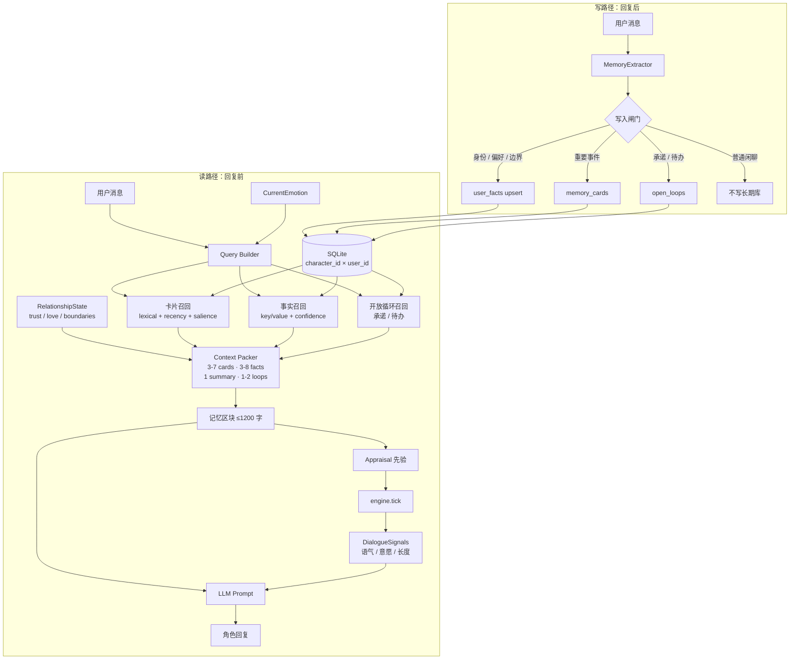
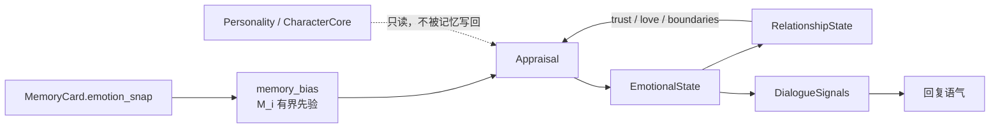

# 关系域长期记忆系统 v0.1

> 目标：让 AI 记住「这个人、这段关系」，而不是把整段聊天记录塞进上下文。
>
> 代码：`memory.py` · 测试：`test_memory_system.py` · 演示：`python memory.py`  
> 相邻控制层：`tolerance.py`（耐受窗）· 设计见 [`TOLERANCE.md`](TOLERANCE.md)

---

## 1. 设计边界

这套记忆系统只做三件事：

1. **记住对方**：身份、偏好、边界、承诺、重要事件、关系摘要。
2. **反过来影响对话**：召回内容进入 prompt；情绪快照可作为 appraisal 先验。
3. **不改变自身底色**：记忆永远不写 `Personality` / `CharacterCore`。

```text
CharacterCore（角色底色，慢变/锁定）
        │
        ├── Personality / OCEAN / 价值排序 / 说话方式
        │
RelationshipState（每个用户一份，可变化）
        │   trust / love / familiarity / boundaries / summary
        │
MemoryCard + UserFact + OpenLoop（每个用户一份）
        │   事件卡 / 结构化事实 / 承诺与待办
        │
CurrentEmotion（每帧状态）
            joy / sadness / anger / fear / ...
```

**硬约束：**

- 记忆按 `(character_id, user_id)` 隔离，不跨用户召回。
- 不存全量聊天记录；长期库只存压缩后的卡片、事实、承诺。
- 进入 prompt 的记忆有预算，默认 ≤ 1200 字。
- 记忆可以影响 appraisal / relationship / 语气，但不能直接改人格参数。

---

## 2. 信息流总图



### 读路径的关键点

- **不是先召回再判断是否相关**：先按 lexical / recency / salience 取候选，再统一打分、截断。
- **关系摘要是最高压缩层**：一到两句话概括「我们是什么关系」，优先于零散事件。
- **开放循环负责连续性**：AI 记得「你上周说周五要汇报」，比记得十段闲聊更像真的记得。
- **预算固定**：卡片 3–7 张、事实 3–8 条、关系摘要 1 条、开放循环 1–2 条。

### 写路径的关键点

- **写入前先过闸门**：不是每句话都值得进长期库。
- **事实用 key/value 存储**：同一 key 的新值会把旧值标记为 `superseded`，保留历史但不污染当前事实。
- **承诺单独存**：进入 `open_loops`，完成后关闭。
- **原文只留引用**：`raw_ref` 指向消息 id，不把整段原文放进记忆卡。

---

## 3. 情绪如何参与



- 卡片保存存储时的 `emotion_snap`、`salience`、`confidence`。
- `memory_bias()` 把这些快照压成一个有上限（默认 ±0.2）的情绪先验。
- 先验只应作用于 `Appraisal` / `RelationshipState`，**不直接拉当前情绪状态，更不写人格**。
- 关系状态反过来影响 appraisal：高 trust 会降低威胁解释，boundary 会提高某些事件的负面权重。

当前 v0.1 只实现了 `memory_bias()` 接口，尚未接入 `engine.tick()`；这是下一步。

---

## 4. 数据模型

### `memory_cards`

压缩后的事件/边界/里程碑卡片。

| 字段 | 说明 |
|---|---|
| `character_id`, `user_id` | 关系域隔离 |
| `scope` | `self` / `relation` / `world` / `session` |
| `kind` | `episode` / `boundary` / `milestone` / `conflict` / `preference` / `note` |
| `summary` | 30–80 字，直接进入 prompt |
| `tags` | 检索辅助 |
| `appraisal` | 事件六维评估快照 |
| `emotion_snap` | 情绪十通道快照 |
| `salience` | 情绪显著性 |
| `confidence` | 记忆可信度 |
| `source` | `user_said` / `observed` / `inferred` / `canon` |
| `raw_ref` | 原文引用，不直接进 prompt |
| `status` | `active` / `superseded` / `deleted` |

### `user_facts`

结构化事实，负责「稳定信息」。

| 字段 | 说明 |
|---|---|
| `key` | 如 `identity.name` / `preference.like.猫` / `boundary.被说教` |
| `value` | 自然语言值，如 `不喜欢被说教` |
| `category` | `identity` / `preference` / `boundary` / `general` |
| `confidence` | 事实可信度 |
| `evidence` | 原文引用列表 |
| `status` | 同一 key 只有一条 `active` |

### `relationships`

每个角色 × 用户一行。

| 字段 | 说明 |
|---|---|
| `trust` / `love` / `familiarity` | 0–1 |
| `boundaries` | 明确边界列表 |
| `summary` | 关系摘要，最高压缩层 |

### `open_loops`

承诺、待办、未解决冲突。

| 字段 | 说明 |
|---|---|
| `summary` | 如「周五项目汇报」 |
| `due_at` | 可选截止时间 |
| `importance` | 0–1 |
| `status` | `open` / `closed` / `cancelled` |

### 检索索引

- 使用 SQLite FTS5 `unicode61`。
- 中文先切成 **CJK bigram** 再写入 `search_text`；英文按词切。
- 没有 FTS5 时自动退回 Python 词法打分。
- 不依赖 embedding，也不需要把中文文本发到外部服务。

---

## 5. 召回评分

卡片：

```text
score = 0.35 * lexical
      + 0.20 * recency       # exp(-age_days / 30)
      + 0.20 * salience
      + 0.15 * kind_importance
      + 0.10 * confidence
```

事实：

```text
score = 0.45 * lexical
      + 0.20 * category_weight
      + 0.20 * confidence
      + 0.15 * recency        # exp(-age_days / 90)
```

召回不是「查聊天记录」，而是「在有限预算内，找回最可能影响此刻对话的几件事」。

---

## 6. 使用方式

```python
from memory import RelationshipMemoryStore, MemoryService

store = RelationshipMemoryStore("memory.db")
memory = MemoryService(store)

# 回复前：构建记忆区块
context = memory.build_context(
    character_id="furina",
    user_id="alice",
    query="今天又被老板骂了。",
)
print(context)

# 回复后：抽取事实 / 边界 / 承诺
memory.remember_turn(
    character_id="furina",
    user_id="alice",
    user_text="我叫小枫，我不喜欢被说教，我答应周五把方案发给你。",
    emotion_snap={"sadness": 0.6, "trust": 0.4},
)

# 重要事件可以显式写入（不依赖规则抽取）
memory.remember_event(
    character_id="furina",
    user_id="alice",
    summary="她第一次主动分享自己的画。",
    kind="milestone",
    emotion_snap={"joy": 0.8, "trust": 0.7},
    salience=0.8,
)
```

接入 `respond_llm`：

```python
from engine import respond_llm
from memory import RelationshipMemoryStore, MemoryService

store = RelationshipMemoryStore("memory.db")
memory = MemoryService(store)

reply = respond_llm(
    engine,
    user_input,
    character_id="furina",
    character_name="Furina",
    user_id="alice",
    relationship_memory=memory,   # 自动召回 + 回复后抽取
)
```

`respond_llm` 的行为：

1. 先跑 `respond()`，得到当前情绪状态。
2. 传入 `relationship_memory` 时，按 `character_id × user_id` 构建记忆区块。
3. 记忆区块注入 prompt；没有 LLM key 时仍回退本地模板。
4. 回复后调用 `remember_turn()`，只写高置信事实/边界/承诺。

---

## 7. GitHub 调研结论

| 项目 | 许可 | 可借鉴 | 不直接采用的原因 |
|---|---|---|---|
| `hanfang/claude-memory-skill` | MIT | `core.md` + `topics/` + 按需读取 + 后台记忆 agent | 面向 coding agent，不是每用户关系记忆 |
| `mem0ai/mem0` | Apache-2.0 | 事实抽取、user/agent/run 作用域、混合检索 | 默认依赖 OpenAI LLM/embedding，引入外部成本 |
| `hsuanshao/AgentMemory` | BUSL-1.1 | L0 原文 → L1 事实 → L2 场景 → L3 人格、异步蒸馏、多租户隔离 | Rust 服务 + 限制性许可，只借鉴架构 |
| `claude-mem` / `repomem` / `limen-memory` | 各异 | 压缩、后台反思、去重 | 主要是会话记忆，不是伴侣关系记忆 |
| `memoryplugin/agent-skills` | 商业服务 | MCP / OAuth 接入方式 | 依赖托管平台 |

**结论：没有可以直接落地的「情绪伴侣记忆 skill」。**  
最合适的是自建一个本地 SQLite 模块，只借鉴 Mem0 的「事实 + 作用域」和 AgentMemory 的「分层 + 异步蒸馏」，不引入新依赖。

---

## 8. 当前限制

1. **规则抽取高精度、低召回**：能稳定抓身份/偏好/边界/承诺，但开放式事件需要 `remember_event()` 或后续 LLM extractor。
2. **没有 embedding**：同义改写可能漏召回；先用 lexical + recency + salience 控成本，后续可加本地向量。
3. **关系摘要尚未自动更新**：目前由 `update_relationship()` 显式写入；下一步做离线 summarizer。
4. **`memory_bias()` 尚未接入 tick**：接口已就绪，但还没有进入 appraisal。
5. **写入是同步的**：生产环境应挪到后台队列，避免阻塞回复。
6. **新旧记忆库并存**：旧的 `engine.MemoryStoreDB` 仍在 `emotion.db`；新系统默认写 `memory.db`。迁移策略待定。

---

## 9. 下一步

- [ ] v0.1.1：可选 LLM extractor（DeepSeek JSON），带 confidence 和 fallback。
- [ ] 关系摘要离线生成：每 N 轮 / 每次会话结束更新 `relationships.summary`。
- [ ] 把 `memory_bias()` 接入 `Appraisal`，并做上限与消融实验。
- [ ] 记忆写入闸门 v2：novelty、future utility、relationship impact、explicit request。
- [ ] 旧 `MemoryStoreDB` 迁移 / 退役。
- [ ] 调试面板：查看某用户的关系摘要、事实、卡片、开放循环。

---

## 10. 测试

```bash
python memory.py
python -m unittest test_memory_system.py -v
```

当前覆盖：

- 用户隔离
- 事实 supersede / 重复确认
- 查询相关性 / 高显著性兜底
- 开放循环生命周期
- prompt 预算
- 关系状态更新
- 忘记用户
- 规则抽取
- 记忆偏置有界性
- SQLite 重开持久化
