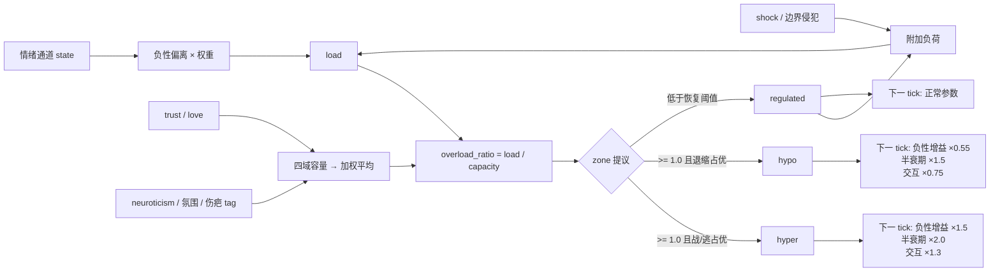

# 忍耐空间 / 耐受窗（Tolerance Window）

> v0.7 控制层 + L5 校准核心 + L5.1 表达/仪表盘（2026-10-26）。代码：`tolerance.py`；集成：`engine.py`；
> 测试：`test_tolerance.py`、`test_engine_tolerance.py`、`test_l5_tolerance.py`、
> `test_l5_1_expression_dashboard.py`；golden：`fixtures/l5_tolerance_golden.json` / `..._legacy.json`。

## 1. 为什么不是“情绪值更高”

情绪通道可以无限叠加，但**超出承受范围后，系统不是同一套规则下数值变大，而是换了一套规则**：

- 调节态：能评估、能表达、能修复。
- 过度唤醒（hyper）：战/逃，更敏感，更难平复，更容易把中性信号读成威胁。
- 低唤醒（hypo）：关机、迟缓、话变少；不是平静。

因此耐受窗不是第 11 个情绪通道，而是一个**控制层状态**：它读取当前通道，改变下一 tick 的负性增益、衰减与交互强度，但**不改写人格**。

## 2. 旧草案的问题

旧公式：

```text
load = Σ_all F_i + Σ_all P_i
if load > window_hi → hyper
if load < window_lo → hypo
```

已废弃，原因：

1. `trust / love` 是慢通道，被重复计入负荷；
2. 默认基线总和已经超过 `window_lo`，低阈值基本不可达；
3. 低负荷被误判为 hypo——平静反而成了失调。

## 3. v0.7 模型

### 3.1 负荷

```text
load = Σ_neg w_i · max(0, state_i − baseline_i)
     + w_trust · max(0, trust_target − trust − deadband)
     + shock_bonus
     + boundary_bonus
```

负性通道权重：

| 通道 | 权重 |
|---|---|
| fear | 0.30 |
| anger | 0.25 |
| sadness | 0.20 |
| disgust | 0.15 |
| guilt | 0.10 |

只有**相对基线向上偏离**的负性通道才计入负荷。`trust / love` 不进入负荷，它们扩展容量。

`trust_target = 1 − 1/(1 + 3.5·love)`；信任天然低于目标，所以留了 `0.25` 的死区，只有明显缺口才算威胁。

附加项：

```text
shock_bonus    = min(0.60, 0.10 × shock 通道数)
boundary_bonus = 0.25（发生边界侵犯）
```

### 3.2 容量（L5 默认：四域加权）

L5 默认把“一个容量”拆成四个承受域：`anger / fear / intimacy / criticism`。
每域先独立计算、独立 clamp，再按权重取有效容量：

```text
c_d = (base + t_d·clamp(trust,0,1) + l_d·clamp(love,0,1))
      × (1 − n_d·(clamp(neuroticism,0,1) − 0.5))
      − p_d·max(0, atmosphere)
      + q_d·max(0, −atmosphere)
      − domain_scar_load·scar_d
c_d = clamp(c_d, 0.35, 1.80)
capacity = clamp(Σ w_d·c_d, 0.35, 1.80)
```

| 域 | 权重 | trust | love | neuro | atm+ | atm− |
|---|---:|---:|---:|---:|---:|---:|
| anger | 0.25 | 0.20 | 0.10 | 0.20 | 0.08 | 0.040 |
| fear | 0.30 | 0.36 | 0.10 | 0.25 | 0.12 | 0.060 |
| intimacy | 0.25 | 0.20 | 0.25 | 0.16 | 0.08 | 0.050 |
| criticism | 0.20 | 0.36 | 0.10 | 0.20 | 0.13 | 0.045 |

系数加权平均对齐旧标量目标（base `.75`、trust `.28`、love `.1375`、
neuro `.205`、atm+ `.102`、atm− `.0495`）。因此默认行为连续，但不再假设
四个域以同样速度变化：

- 高信任更扩 `fear / criticism`，对 `anger / intimacy` 影响较小；
- 高爱更扩 `intimacy`；
- 高神经质与紧绷氛围更压 `fear / criticism`；
- 每域先 clamp 再平均，单个域触底不会把其它域一起拖到最低。

`capacity_model="scalar"`（或 `legacy_tolerance=True`）仍走旧的单标量公式，
逐值复现 pre-L5：

```text
capacity = (0.75 + 0.25·trust + 0.15·love)
         × (1 − 0.20·(neuroticism − 0.5))
         − 0.10·max(0, atmosphere)
         + 0.05·max(0, −atmosphere)
         − 0.15·scar_pressure
```

### 3.2.1 伤疤按事件类型压缩

`scar_pressure_by_tag` 把伤疤 tag 映射到域，同域取 max，不累加：

| 域 | 读取的 tag |
|---|---|
| anger | `social_hurt`, `criticism` |
| fear | `social_hurt`, `cold_shoulder` |
| intimacy | `cold_shoulder`, `self_blame` |
| criticism | `criticism`, `social_hurt` |

- 每域压缩量 = `domain_scar_load × scar_d`，默认 `0.20`。
- 未提供 tag map（旧调用）时，四个域都回退到全局 `scar_pressure`。
- 空 map / 未知 tag：不压缩任何域。
- scalar / legacy：忽略 tag map，仍用 global max `scar_pressure` 与旧 `scar_load`。

### 3.2.2 meta 负荷（默认关闭）

`tolerance_meta_load_enabled=False` 时，L3.5 的 `tolerance_load_bias` 仍只写 trace。
开启后（且 `meta_emotion_enabled=True`、非 legacy、`capacity_model="multi"`）：

```text
instant_load += min(max(0, tolerance_load_bias), min(0.20, meta_load_cap))
```

- 硬上限 `0.20`，`meta_load_cap` 只能调低。
- 加在 instant load 上再进入包络，不直接加到上一帧 load，避免逐 tick 累加。
- meta 使用**上一 tick** 的 zone / overload；本 tick 的 tolerance 更新在其后。
- 伤疤压缩 capacity，meta 增加 load，两者不重复计同一来源。

### 3.3 负荷包络

```text
recovery      = exp(−elapsed_hours / 4.0)
load          = max(instant_load, previous_load × recovery)
overload_ratio = load / max(0.05, capacity)
```

当前事件立即抬高负荷；没有新事件时按 4 小时半衰期回落。不是每 tick 直接清空，也不是无限累加。

### 3.4 区间判定

```text
if overload_ratio >= 1.0:
    fight    = anger + disgust + 0.5·fear
    withdraw = sadness + guilt + longing + 0.5·fear
    zone = hypo if withdraw > fight × 1.1 else hyper

if zone in (hyper, hypo) and overload_ratio >= 0.65:
    zone = 原区间          # 滞回，不急着回调节态

else:
    zone = regulated
```

- **低负荷永远是调节态**，不是 hypo。
- hypo 是“过载后的关机”，不是“平静”。
- 区间切换需要连续 **2 tick** 提议，避免阈值附近抖动。

## 4. 模式如何影响下一 tick

| 参数 | regulated | hyper | hypo |
|---|---|---|---|
| 负性 appraisal 增益 | ×1.0 | ×1.5 | ×0.55 |
| 负性通道半衰期 | ×1.0 | ×2.0 | ×1.5 |
| 负性交互强度 | ×1.0 | ×1.3 | ×0.75 |

只作用于负性通道：`sadness / anger / fear / disgust / guilt`。
`joy / trust / love / longing` 不受这些倍率影响。

实现顺序：

1. tick 开始时用**上一 tick 的 zone** 决定衰减倍率；
2. appraisal 门控后乘以负性增益；
3. 交互矩阵按 `interaction_scale` 缩放负性增量；
4. 若开启 meta load，在 tolerance 更新前用**上一 tick 的 zone / overload**
   计算 `tolerance_load_bias`；
5. tick 末尾调用 `tolerance.update()`，为下一 tick 准备 zone。

因此区间切换不会在同一 tick 内“自我放大”，meta bias 也不会在同一 tick
形成“meta → tolerance → meta”的循环。

## 5. 信息流



## 6. 用法

```python
from engine import EmotionEngine, EmotionalState, Personality, Appraisal, MemoryStore, SensitizationStore
from tolerance import ToleranceConfig

engine = EmotionEngine(
    state=EmotionalState(),
    personality=Personality(neuroticism=0.7),
    memory=MemoryStore(),
    scars=SensitizationStore(),
    # L5 默认 multi；legacy_tolerance=True 切回 pre-L5 标量。
    tolerance_config=ToleranceConfig(domain_scar_load=0.20),
    legacy_tolerance=False,
    # 默认只让 meta 写 trace；显式开启后才消费 tolerance_load_bias。
    meta_emotion_enabled=True,
    tolerance_meta_load_enabled=False,
)

result = engine.tick(
    Appraisal(
        goal_relevance=0.9,
        goal_conduciveness=-0.9,
        expectedness=0.2,
        other_agency=0.9,
        coping_potential=0.1,
    ),
    boundary_violation=True,
)

print(result["tolerance"])
# {'load': ..., 'capacity': ..., 'zone': 'regulated|hyper|hypo',
#  'overload_ratio': ..., 'pending_zone': ..., 'pending_ticks': ...,
#  'capacity_model': 'multi',
#  'capacity_by_domain': {'anger': ..., 'fear': ...,
#                         'intimacy': ..., 'criticism': ...},
#  'meta_load_bias': 0.0}
```

A/B 对照：

```python
legacy = EmotionEngine(
    state=EmotionalState(), personality=Personality(),
    memory=MemoryStore(), scars=SensitizationStore(),
    legacy_tolerance=True,
)
# legacy.tolerance.to_dict() 只返回旧六个键；
# fixtures/l5_tolerance_golden_legacy.json 锁定逐值行为。
```

直接驱动 `ToleranceState` 时，L5 新参数都是可选的：

```python
tolerance.update(
    state=..., baseline=..., trust=..., love=...,
    trust_target_value=..., neuroticism=..., atmosphere=...,
    scar_pressure=0.6,
    scar_pressure_by_tag={"criticism": 0.6},  # None → 回退全局
    meta_load_bias=0.2,
    elapsed_hours=0.0,
    capacity_model="multi",                   # 或 "scalar"
)
```

`tick()` 与 `wake()` 都接受 `now=`，便于确定性测试。`wake()` 会把离线小时数传给负荷恢复。

### 快照

`save_snapshot()` / `load_snapshot()` 会保存并恢复：

- 10 通道状态与 `atmosphere`
- `legacy_interactions` / `legacy_slow_channels` / `legacy_atmosphere`
- `legacy_tolerance`（L5 标量兼容模式）
- `tolerance` 状态：旧六字段；multi 模式另存 `capacity_model`、
  `capacity_by_domain`、`meta_load_bias`
- `events_today` / `positive_events`
- `_last_saga` / `_recent_shocks`
- 快照时间（作为恢复后的计时起点）
- 旧伤疤

payload 带 `schema_version`（`engine.SNAPSHOT_VERSION`，当前 `2`）。旧版
“只存通道字典”或没有版本号的 payload 由 `_migrate_snapshot_payload()` 统一
迁移到当前版本；来自更新版本的快照会拒绝加载，避免旧代码截断新字段。
新增持久化字段时：递增 `SNAPSHOT_VERSION`、在迁移函数里补分支、并补
`test_p0_maintainability.py` 的版本测试。

`ToleranceConfig` 是代码级配置，**不写入快照**；要精确续跑自定义参数，
加载时需给目标引擎重新提供同一个 `tolerance_config`。旧快照没有新键时
按默认 multi 迁移，旧六字段值保持不变；`legacy_tolerance=True` 的快照会
在重建状态前先恢复 flag，并把配置与状态都切回 scalar。

meta state、profile、`meta_emotion_enabled` 与 `tolerance_meta_load_enabled`
仍不写入快照。旧版“只存通道字典”的快照仍可读取。L3 corrected 模式在加载和
`wake()` 入口都会把 atmosphere clamp 到 `[-1, 1]`；legacy 模式保持旧值不 clamp。

### L3.5 元情绪负荷（默认仅观测）

`meta_emotion.py` 会输出 `tolerance_load_bias`（`[0, 0.2]`，只统计
`suppress / ruminate / avoid`）。默认仍只写 trace：

- `tolerance_meta_load_enabled=False` 时，`load` / `capacity` / `zone`
  完全不受元情绪影响；
- 开启后，bias 作为有界附加负荷进入 instant load（见 3.2.2）；
- 伤疤压缩 capacity、meta 增加 load，两者可以共存，但不重复计同一来源；
- 快照不保存 meta state、profile 或 enable 开关，恢复后需重新配置。

## 7. 与表达层（L5.1）

L5.1 让本地模板、Live2D 参数与行为倾向使用同一个 zone；`regulated`
路径保持 L5 之前的表达式与模板选择不变。

### 7.1 本地模板

- `regulated`：仍按主导情绪从 `_CHARACTER_POOLS` 选台词。
- `hyper` / `hypo`：zone 优先，从角色专属 `_ZONE_POOLS` 选台词；
  未注册角色回退 `default`。
- hyper 使用战/逃、拒绝、防御性短句；hypo 使用话少、迟缓、关机的短句。
- `respond()` 在 hyper / hypo 下把 `needs_llm` 置为 `True`，允许 LLM
  在不改变数值的前提下细化表达；没有 API 时仍用本地 zone 模板。

### 7.2 Live2D 表情

`_expression_params(state, zone)` 先计算原映射：

```text
brow = -0.5 + joy·0.8 − sadness·0.6
mouth = -0.3 + joy·0.7 − anger·0.3
eye = 0.8 + surprise·0.4 − fear·0.1
blush = min(1, joy·0.4 + guilt·0.3)
gaze = longing·0.5 − fear·0.3
head = sadness·0.3 + guilt·0.2
```

再按 zone 叠加：

| 参数 | hyper | hypo |
|---|---|---|
| brow | −0.15 | ×0.55 − 0.18 |
| mouth | −0.20 | ×0.45 − 0.10 |
| eye | +0.15 | ×0.62 |
| blush | ×0.55 | ×0.35 |
| gaze | −0.20 | ×0.45 |
| head | 不变 | ×0.60 + 0.10 |

hyper / hypo 的最终六个参数 clamp 到 `[-1, 1]`；regulated 不 clamp、
不叠加修正，逐值保持旧映射。效果上 hyper 是紧张防御脸，hypo 是低唤醒关机脸。

### 7.3 行为倾向

`_action_tendency()` 仍输出 `approach / withdraw / still`：

- atmos > 0.3 时 `avoid ×1.3`；
- hyper：`approach ×0.85`、`avoid ×1.25`；
- hypo：`approach ×0.60`、`avoid ×0.55`，方向阈值从 `1.2` 提高到 `1.35`。

hypo 不再只压低趋近、保留完整回避；趋近与回避都迟缓，同等冲突更容易
落到 `still`，只有压倒性的回避才保持 `withdraw`。

### 7.4 LLM 提示

`_mood_hint()` 继续把 zone 翻成行为指令，而不是把数值丢给 LLM：

- hyper：“容易战或逃，语气更冲、更防御，很难继续忍耐”
- hypo：“反应变慢、想关机、话变少，这不是平静”

### 7.5 仪表盘

`dashboard/index.html` 新增耐受窗卡片：

- `load` / `capacity` 实线；
- anger / fear / intimacy / criticism 四条虚线容量；
- 每个历史点按其 `zone` 绘制背景区间带：regulated 绿、hyper 红、hypo 蓝；
- 当前 zone 徽标、load / capacity / overload_ratio 与四域读数；
- 图例支持逐条隐藏；角色切换 / 重置时曲线清空。

后端 `/api/state` 写入历史时使用 `tolerance_history_point()`，保留
`load`、`capacity`、`zone`、`overload_ratio`、`capacity_by_domain`；
`/api/history` 直接返回这些点。scalar / 旧历史点没有四域时，前端显示 `—`。

## 8. 测试

```bash
python -m unittest test_tolerance.py test_engine_tolerance.py -v
python -m unittest test_l5_tolerance.py test_l5_1_expression_dashboard.py -v

python scripts/generate_l5_tolerance_golden.py --check
python scripts/generate_l5_tolerance_golden.py --legacy --check
```

覆盖：

- `l5line.run_scenario` / `run_sequence` 共享 current / legacy 更新路径
- L5 current / legacy 两套 golden（15 场景 / 41 步，误差 `<1e-9`）
- 四域容量手算、加权平均、每域 clamp、域特化
- 默认 multi 与旧 scalar 的漂移上界
- 伤疤按 tag 定向压缩、同域 max、空 map / 未知 tag、旧全局回退
- meta bias 附加、封顶、不累加、`meta_load_cap` 只降不升
- 引擎只在 meta + load 开关都开启且 multi 时消费；legacy 忽略
- meta 使用上一 tick zone / overload，trace on/off 下只计算一次
- 序列化旧六键 / 新三键、非法 payload、快照往返与配置重供
- 低负荷永不 hypo、两 tick 滞回、fuzz 有限性与边界
- `tolerance.py` AST 导入边界
- 既有基线：负荷≈0、慢通道不重复计负荷、hyper/hypo、模式倍率、
  冲击/边界附加、引擎 tick / prompt / respond / 可注入时钟
- L5.1：regulated 表情逐值不变；hyper 紧张、hypo 低唤醒；hypo 行为
  不再放大回避；zone 模板优先；仪表盘历史点与四域序列字段完整

验收结果：

```text
L5 38 tests + L5.1 12 tests, OK；L4 后全套 285 tests, OK
golden: 15 scenarios / 41 steps（current + legacy）
calm current: capacity 0.862350
  domains anger 0.832 / fear 0.878 / intimacy 0.865 / criticism 0.8735
calm legacy:  capacity 0.857500（旧公式逐值）
anger_hyper:  1 tick regulated → 2 tick hyper
withdrawal_hypo: 2 tick hypo
recovery: hyper → 4h 衰减 → pending → regulated
scar social_hurt 0.6: anger/fear/criticism −0.12，intimacy 不变
capacities: floor 0.35 / ceiling 1.80
meta bias 0.05/0.20/0.50 → load +0.05/+0.20/+0.20
L5.1: regulated 表情映射保持旧值；hyper/hypo 输出 clamp 到 [-1,1]
```

## 9. 已知限制

- 四域容量仍是**手调系数 + golden 锁定**，不是从数据学习出的参数。
- 伤疤同域取 max，不累加；跨域的长期扩散（一个伤疤逐渐影响全部域）尚未实现。
- 长期压力导致的基线容量下降（人格慢漂移）尚未接入。
- L5.1 的表情修正系数是手工规则，只锁定方向和边界，尚未做真实 Live2D
  观感 A/B；hyper / hypo 台词每角色仅 3 条，长期会重复。
- 仪表盘只在 `/api/state` 轮询时累积点；`/api/event` 返回的状态会即时
  绘图，但不回写服务端历史。历史数组上限 300 点，前端显示 120 点。
- meta load 默认关闭，且只有 `multi + 非 legacy` 才消费；尚未做长期 A/B 曲线。
