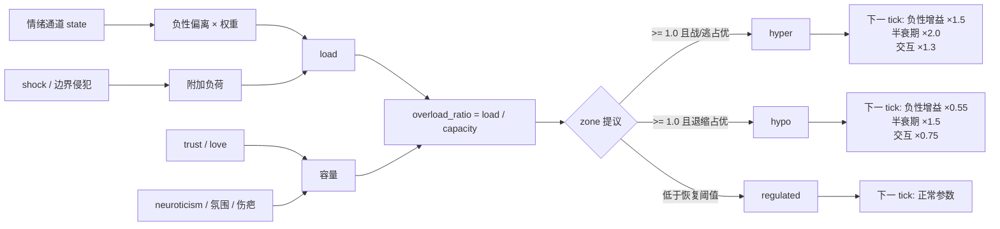

# 忍耐空间 / 耐受窗（Tolerance Window）

> v0.7 已实现。代码：`tolerance.py`；集成：`engine.py`；测试：`test_tolerance.py`、`test_engine_tolerance.py`。

## 1. 为什么不是“情绪值更高”

情绪通道可以无限叠加，但**超出承受范围后，系统不是同一套规则下数值变大，而是换了一套规则**：

- 调节态：能评估、能表达、能修复。
- 过度唤醒（hyper）：战/逃，更敏感，更难平复，更容易把中性信号读成威胁。
- 低唤醒（hypo）：关机、迟缓、话变少；不是平静。

因此耐受窗不是第 11 个情绪通道，而是一个**控制层状态**：它读取当前通道，改变下一 tick 的负性增益、衰减与交互强度，但**不改写人格**。

## 2. 旧草案的问题

旧公式：

```text
load = Σ_all F_i + Σ_all P_i
if load > window_hi → hyper
if load < window_lo → hypo
```

已废弃，原因：

1. `trust / love` 是慢通道，被重复计入负荷；
2. 默认基线总和已经超过 `window_lo`，低阈值基本不可达；
3. 低负荷被误判为 hypo——平静反而成了失调。

## 3. v0.7 模型

### 3.1 负荷

```text
load = Σ_neg w_i · max(0, state_i − baseline_i)
     + w_trust · max(0, trust_target − trust − deadband)
     + shock_bonus
     + boundary_bonus
```

负性通道权重：

| 通道 | 权重 |
|---|---|
| fear | 0.30 |
| anger | 0.25 |
| sadness | 0.20 |
| disgust | 0.15 |
| guilt | 0.10 |

只有**相对基线向上偏离**的负性通道才计入负荷。`trust / love` 不进入负荷，它们扩展容量。

`trust_target = 1 − 1/(1 + 3.5·love)`；信任天然低于目标，所以留了 `0.25` 的死区，只有明显缺口才算威胁。

附加项：

```text
shock_bonus    = min(0.60, 0.10 × shock 通道数)
boundary_bonus = 0.25（发生边界侵犯）
```

### 3.2 容量

```text
capacity = (0.75 + 0.25·trust + 0.15·love)
         × (1 − 0.20·(neuroticism − 0.5))
         − 0.10·max(0, atmosphere)
         + 0.05·max(0, −atmosphere)
         − 0.15·scar_pressure
```

并夹在 `[0.35, 1.80]`。含义：

- 高信任、高爱 → 容量更大；
- 高神经质 → 窗口更窄；
- 紧绷氛围 → 容量下降；
- 旧伤疤 → 同类事件更容易击穿。

### 3.3 负荷包络

```text
recovery      = exp(−elapsed_hours / 4.0)
load          = max(instant_load, previous_load × recovery)
overload_ratio = load / max(0.05, capacity)
```

当前事件立即抬高负荷；没有新事件时按 4 小时半衰期回落。不是每 tick 直接清空，也不是无限累加。

### 3.4 区间判定

```text
if overload_ratio >= 1.0:
    fight    = anger + disgust + 0.5·fear
    withdraw = sadness + guilt + longing + 0.5·fear
    zone = hypo if withdraw > fight × 1.1 else hyper

if zone in (hyper, hypo) and overload_ratio >= 0.65:
    zone = 原区间          # 滞回，不急着回调节态

else:
    zone = regulated
```

- **低负荷永远是调节态**，不是 hypo。
- hypo 是“过载后的关机”，不是“平静”。
- 区间切换需要连续 **2 tick** 提议，避免阈值附近抖动。

## 4. 模式如何影响下一 tick

| 参数 | regulated | hyper | hypo |
|---|---|---|---|
| 负性 appraisal 增益 | ×1.0 | ×1.5 | ×0.55 |
| 负性通道半衰期 | ×1.0 | ×2.0 | ×1.5 |
| 负性交互强度 | ×1.0 | ×1.3 | ×0.75 |

只作用于负性通道：`sadness / anger / fear / disgust / guilt`。
`joy / trust / love / longing` 不受这些倍率影响。

实现顺序：

1. tick 开始时用**上一 tick 的 zone** 决定衰减倍率；
2. appraisal 门控后乘以负性增益；
3. 交互矩阵按 `interaction_scale` 缩放负性增量；
4. tick 末尾调用 `tolerance.update()`，为下一 tick 准备 zone。

因此区间切换不会在同一 tick 内“自我放大”。

## 5. 信息流



## 6. 用法

```python
from engine import EmotionEngine, EmotionalState, Personality, Appraisal, MemoryStore, SensitizationStore

engine = EmotionEngine(
    state=EmotionalState(),
    personality=Personality(neuroticism=0.7),
    memory=MemoryStore(),
    scars=SensitizationStore(),
)

result = engine.tick(
    Appraisal(
        goal_relevance=0.9,
        goal_conduciveness=-0.9,
        expectedness=0.2,
        other_agency=0.9,
        coping_potential=0.1,
    ),
    boundary_violation=True,
)

print(result["tolerance"])
# {'load': ..., 'capacity': ..., 'zone': 'regulated|hyper|hypo',
#  'overload_ratio': ..., 'pending_zone': ..., 'pending_ticks': ...}
```

`tick()` 与 `wake()` 都接受 `now=`，便于确定性测试。`wake()` 会把离线小时数传给负荷恢复。

### 快照

`save_snapshot()` / `load_snapshot()` 现在会保存并恢复：

- 10 通道状态与 `atmosphere`
- `tolerance`（load / capacity / zone / hysteresis）
- `events_today` / `positive_events`
- `_last_saga` / `_recent_shocks`
- 快照时间（作为恢复后的计时起点）
- 旧伤疤

旧版“只存通道字典”的快照仍可读取。

## 7. 与表达层

- `respond()` 的 `action` 会参考 zone：hyper 压低趋近、放大回避；hypo 压低趋近。
- `_mood_hint()` 会把 zone 翻成行为指令，而不是把数值丢给 LLM：
  - hyper：“容易战或逃，语气更冲、更防御，很难继续忍耐”
  - hypo：“反应变慢、想关机、话变少，这不是平静”
- 数值本身只保留在调试输出里，不作为 prompt 的主要表达。

## 8. 测试

```bash
python -m unittest test_tolerance.py -v

python -m unittest test_engine_tolerance.py -v
```

覆盖：

- 基线调节态、负荷≈0
- 高 trust/love 扩展容量；高神经质收窄
- 慢通道不重复计负荷
- 负性事件进入 hyper；持续退缩进入 hypo；低负荷永不 hypo
- 两 tick 滞回；恢复需要滞回 + 时间；负荷自然衰减
- 冲击/边界附加负荷
- 模式倍率
- 序列化与非法 zone 回退
- 引擎 tick 返回 tolerance
- hyper 放大负性 appraisal、拖慢负性衰减
- 快照完整往返
- 可注入时钟
- prompt / respond 暴露 zone

## 9. 已知限制

- 目前是**单标量容量**，不是“对愤怒 / 恐惧 / 亲密 / 批评分别有不同容量”的多维模型。
- `scar_pressure` 取最强伤疤，不区分事件类型；同类伤疤叠加尚未实现。
- 长期压力导致的基线容量下降（人格慢漂移）尚未接入。
- 仪表盘还没有 tolerance 折线/区间带。
- 参数是手调默认值，尚未用 golden set 校准。
